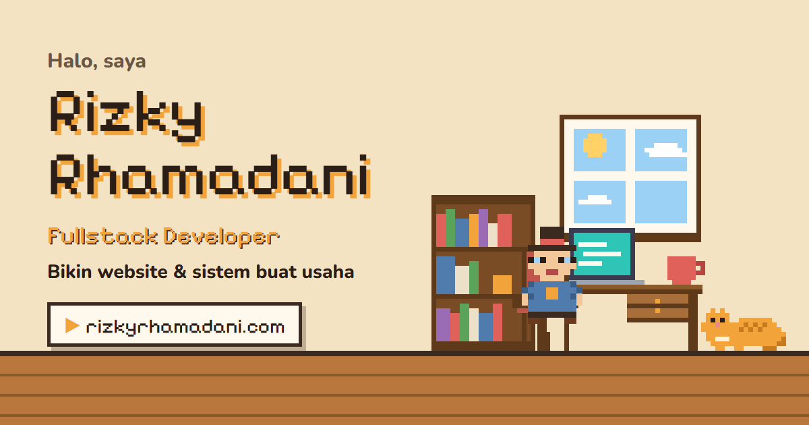

# Rumah Pixel · Portofolio Rizky Rhamadani

**🏠 Live: [rizkyrhamadani.com](https://rizkyrhamadani.com)** · Versi ringkas untuk perekrut: [rizkyrhamadani.com/ringkas](https://rizkyrhamadani.com/ringkas)



> **English:** My portfolio as a living pixel-art house. Every section is a room with characters who walk,
> talk, and follow a real daily schedule. Built with Next.js, React, TypeScript, and Supabase.

Portofolio ini bukan halaman biasa, tapi rumah pixel yang hidup. Setiap bagian adalah ruangan, dan
penghuninya bergerak, mengobrol, dan mengikuti jam sungguhan tanpa perlu dikendalikan pengunjung.

## Ruangan

| Ruangan | Isi |
|---|---|
| Ruang tamu | Perkenalan dan jasa |
| Ruang kerja | Proyek, ditampilkan di layar laptop dengan galeri gambar |
| Galeri skill | Skill dalam bingkai |
| Ruang sertifikat | Perjalanan belajar dan sertifikat |
| Kamar | Rutinitas harian Rizky |
| Kontak | Cara kerja sama, testimoni, dan form kontak |

## Yang membuatnya berbeda

- **Satu karakter, satu ruangan.** Setiap ruangan menjalankan naskah sendiri, tapi ada daftar kehadiran
  global: karakter harus "dipesan" dulu sebelum masuk, jadi tidak pernah muncul di dua ruangan sekaligus.
- **Mengikuti jam asli.** Rizky pindah ruangan sepanjang hari, sholat di kamar saat waktunya, dan tidur
  di malam hari. Saat ia tidur, rumah jadi sepi dan penghuni lain berbicara pelan.
- **Semua karakter digambar dari huruf.** Setiap sprite adalah susunan baris huruf, satu huruf satu warna,
  lalu digambar sebagai SVG. Tidak ada file gambar untuk karakter dan perabot.
- **Suara per ruangan.** Musik, efek suara, dan suara karakter dibuat dengan Web Audio API; hanya ruangan
  yang sedang dilihat yang terdengar. Suara mati secara bawaan.
- **Dua bahasa** (Indonesia dan Inggris), **mode siang dan malam**, dan tampilan yang nyaman di HP.
- **Versi ringkas** satu halaman yang rapi saat dicetak, untuk perekrut yang ingin membaca cepat.

## Panel admin

Isi portofolio (proyek, galeri, skill, sertifikat, timeline, testimoni) dikelola lewat panel admin dan
disimpan di Supabase. Keamanan diatur di database dengan Row Level Security: pengunjung hanya bisa
membaca, dan hanya akun admin yang bisa mengubah data atau mengunggah gambar.

## Teknologi

Next.js · React · TypeScript · Tailwind CSS · Framer Motion · Supabase (PostgreSQL, Auth, Storage, RLS) ·
Web Audio API · Vercel

## Struktur singkat

```
src/
  app/              halaman utama, versi ringkas, dan panel admin
  components/
    game/           mesin adegan, sprite, pemeran, perabot
    rooms/          naskah tiap ruangan (siang, malam, tamu)
  content/          teks dialog, rutinitas, dan isi statis
  lib/              audio, suara, data Supabase
```

## Menjalankan di komputer sendiri

```bash
npm install
npm run dev
```

Buat file `.env.local` berisi `NEXT_PUBLIC_SUPABASE_URL`, `NEXT_PUBLIC_SUPABASE_ANON_KEY`, dan
`NEXT_PUBLIC_WEB3FORMS_KEY`, lalu buka http://localhost:3000.

## Hak cipta

© 2026 Rizky Rhamadani. Kode ini dipublikasikan untuk dilihat sebagai portofolio. Desain, karakter,
dan kode tidak boleh disalin atau dipakai ulang tanpa izin.

---

Butuh website atau sistem untuk usaha? **[rizkyrhamadani.com](https://rizkyrhamadani.com)** · ryzkirham@gmail.com
